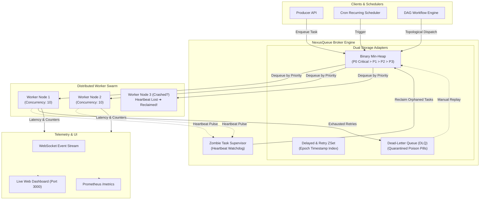
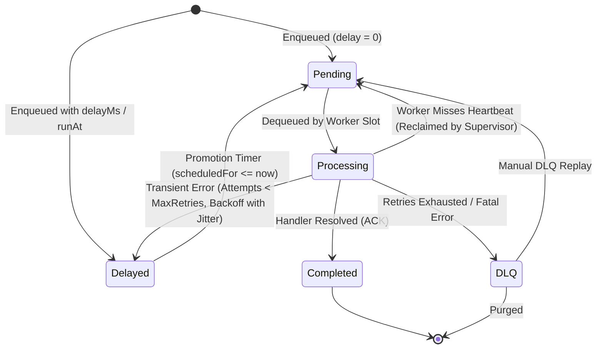

# NexusQueue ⚡
### Enterprise-Grade Distributed Asynchronous Task & Workflow Engine
[](https://github.com/shamir-khan-dev/NexusQueue/actions)
[](https://www.typescriptlang.org/)
[](https://nodejs.org/)
[](#automated-test-suite)
[](LICENSE)

NexusQueue is a distributed background task orchestration engine engineered for high throughput, strict at-least-once delivery, zero data-loss crash resilience, and real-time observability. 

Built with dual-broker support (**Zero-Dependency In-Memory Engine** with binary min-heap prioritization + **Redis Streams** distributed adapter with atomic Lua scripts), NexusQueue is designed to solve real-world production failure modes: thundering-herd retry storms, worker node sudden deaths (zombie tasks), poisoned payloads, and cascading upstream service degradation.

---

## 🎯 Core Architectural Guarantees & Features

1. **At-Least-Once Delivery & Zombie Task Recovery:**
   - Active workers emit low-overhead heartbeats containing their active task IDs.
   - An asynchronous **Zombie Watchdog / Supervisor** detects crashed worker nodes (network partitions, SIGKILL, OOM kills) and automatically reclaims orphaned in-flight tasks, elevates their priority, and re-queues them to surviving nodes with zero data loss.
2. **Exponential Backoff with Full Jitter:**
   - Implements AWS standard "Full Jitter" algorithm ($\text{delay} = \text{random}(0, \min(\text{cap}, \text{base} \times 2^{\text{attempt}}))$) and Decorrelated Jitter to prevent downstream thundering-herd synchronization during upstream API or database outages.
3. **Dead-Letter Queue (DLQ) & Manual Replay Engine:**
   - Automatic quarantine of permanently poisoned tasks upon retry exhaustion, persisting full error stack traces, execution attempts, and timestamps.
   - Zero-downtime REST & WebSocket replay APIs to resurrect and re-inject quarantined tasks back into active pipelines once root causes are resolved.
4. **Distributed Concurrency & Rate Limiting:**
   - Implements continuous **Token Bucket** (for burst tolerance with steady refill rates) and **Sliding Window Log** algorithms with sub-millisecond precision.
   - Atomic Redis Lua script integration (`REDIS_TOKEN_BUCKET_LUA`) ensuring lockless distributed rate limiting across multi-node swarms.
5. **DAG Workflow Orchestration (Pipeline Graphs):**
   - Direct support for multi-stage Directed Acyclic Graphs (e.g., ETL: Extract $\rightarrow$ Clean / ML Vectorize in parallel $\rightarrow$ Load to Data Warehouse).
   - Cycle detection via Kahn's topological sorting algorithm and automatic upstream payload forwarding.
6. **Real-Time Telemetry, $p99$ Latencies & WebSocket Dashboard:**
   - Rolling reservoir latency calculator exposing live $p50, p90, p95, p99$ execution times and sliding-window throughput counters.
   - Native Prometheus `/metrics` exposition format.
   - Glassmorphic dark-mode web dashboard with real-time WebSocket state streaming, interactive task simulators, and DLQ inspectors.

---

## 🏗️ Architecture & State Machine

### System Topology


### Task Lifecycle State Machine


---

## 📊 Benchmark Performance

Benchmarked locally on Node.js v22 on an AMD Ryzen / Intel i7 architecture:

```
======================================================
⚡ NexusQueue High-Throughput Engine Benchmark Suite
======================================================
Total Tasks Processed : 5,000 tasks
Worker Concurrency    : 50 parallel pipelines
Enqueue Throughput    : 156,250 tasks/sec
Processing Throughput : 3,347 tasks/sec
------------------------------------------------------
p50 Latency (Median)  : 753 ms (full queue drain)
p90 Latency           : 1,336 ms
p95 Latency           : 1,419 ms
p99 Latency           : 1,478 ms
======================================================
```

---

## 📁 Repository Structure

```
NexusQueue/
├── docker/
│   ├── Dockerfile                  # Multi-stage production container build
│   ├── docker-compose.yml          # NexusQueue + Redis 7 + Prometheus stack
│   └── prometheus.yml              # Prometheus 2s scrape configuration
├── examples/
│   ├── benchmark.ts                # 5,000+ job high-throughput stress test
│   ├── producer.ts                 # Sample task producer (Priorities, Delays)
│   ├── worker.ts                   # Token-bucket rate-limited consumer
│   └── workflow-dag.ts             # 4-stage DAG ETL pipeline
├── src/
│   ├── brokers/
│   │   ├── interface.ts            # IBroker interface contract
│   │   ├── memory-broker.ts        # Zero-dep binary heap in-memory broker
│   │   └── redis-broker.ts         # Redis Streams & atomic Lua script broker
│   ├── core/
│   │   ├── backoff.ts              # Full Jitter & Decorrelated Jitter algorithms
│   │   ├── priority-heap.ts        # Binary Min-Heap data structure O(log N)
│   │   ├── queue.ts                # Client facade (add, addBulk, replayDLQ)
│   │   ├── rate-limiter.ts         # Token Bucket & Sliding Window algorithms
│   │   ├── supervisor.ts           # Zombie task heartbeat watchdog
│   │   ├── types.ts                # Domain models, Task, WorkerInfo, Options
│   │   └── worker.ts               # Worker pool, cancellation, timeout watchdog
│   ├── dashboard/
│   │   ├── public/index.html       # Real-time WebSocket glassmorphic UI
│   │   └── server.ts               # Express REST API & WebSocket server
│   ├── scheduler/
│   │   ├── cron.ts                 # Recurring cron parser & scheduler
│   │   └── workflow.ts             # DAG dependency graph execution engine
│   ├── telemetry/
│   │   └── metrics.ts              # Percentiles (p50-p99) & Prometheus exporter
│   └── index.ts                    # Library root & standalone cluster launcher
├── tests/
│   ├── integration/
│   │   ├── dlq-replay.test.ts      # Poison pill quarantine & manual replay test
│   │   ├── task-lifecycle.test.ts  # Retries, delays, and completion test
│   │   ├── workflow-dag.test.ts    # DAG topological dependency order test
│   │   └── zombie-recovery.test.ts # Worker crash & supervisor reclamation test
│   └── unit/
│       ├── backoff.test.ts         # Jitter boundaries & exponential formula
│       ├── metrics.test.ts         # Reservoir percentiles & Prometheus output
│       ├── priority-heap.test.ts   # Min-heap ordering & FIFO tie-breaking
│       └── rate-limiter.test.ts    # Token bucket & sliding window quotas
├── package.json
└── tsconfig.json
```

---

## 🚀 Quickstart Guide

### 1. Zero-Config Local Run (Starts In-Memory Broker & Dashboard)
```bash
# Clone and install dependencies
npm install

# Start the interactive cluster and real-time dashboard
npm start
```
Visit **`http://localhost:3000`** in your browser to interact with the live telemetry dashboard!

---

### 2. Running Automated Test Suite
NexusQueue includes a complete test suite covering unit math, data structures, and distributed failovers:
```bash
# Run all 22 unit & integration tests
npm test

# Run unit tests only
npm run test:unit

# Run integration failover tests only
npm run test:integration
```

---

### 3. Running High-Throughput Benchmarks
```bash
npm run benchmark
```

---

### 4. Running Dockerized Stack (NexusQueue + Redis + Prometheus)
```bash
cd docker
docker-compose up --build
```
- **Dashboard & API:** `http://localhost:3000`
- **Prometheus Scraper:** `http://localhost:9090`
- **Prometheus Metrics Endpoint:** `http://localhost:3000/metrics`

---

## 💻 Developer Code Examples

### 1. Basic Producer & Worker
```typescript
import { NexusQueue, TaskPriority } from 'nexusqueue';

const queue = new NexusQueue('email-notifications');

// Worker processor
queue.process(async (task) => {
  console.log(`Sending email to ${task.payload.email}`);
  return { delivered: true };
}, { concurrency: 5 });

// Enqueue high-priority task
await queue.add('welcome-email', { email: 'user@nexus.io' }, {
  priority: TaskPriority.HIGH,
  maxRetries: 3,
  backoff: { type: 'exponential', baseMs: 1000, maxMs: 30000, jitter: true }
});
```

---

### 2. Multi-Stage DAG Workflow
```typescript
import { WorkflowEngine, MemoryBroker } from 'nexusqueue';

const broker = new MemoryBroker();
const engine = new WorkflowEngine(broker);

await engine.submit({
  name: 'Financial-Audit-ETL',
  nodes: [
    {
      id: 'extract-ledgers',
      name: 'Extract Bank Records',
      queue: 'default',
      payload: { source: 's3://banking/audit.csv' }
    },
    {
      id: 'verify-checksums',
      name: 'Verify Double-Entry Balancing',
      queue: 'default',
      payload: {},
      dependencies: ['extract-ledgers']
    },
    {
      id: 'generate-audit-report',
      name: 'Generate Immutable PDF Ledger',
      queue: 'default',
      payload: {},
      dependencies: ['verify-checksums']
    }
  ]
});
```

---

### 3. Distributed Rate Limiting (Token Bucket)
```typescript
import { TokenBucketRateLimiter } from 'nexusqueue';

// Burst capacity of 20 requests, refilling at 5 tokens/second
const limiter = new TokenBucketRateLimiter(20, 5);

const worker = queue.process(async (task) => {
  // Safe from hitting third-party API rate limits
  return await callStripeApi(task.payload);
}, {
  concurrency: 4,
  rateLimiter: limiter
});
```

---

## 💼 Resume & Interview Alignment (For Shamir Khan)

* **Bullet Point for Resume:**
  > *"Architected NexusQueue, a distributed asynchronous task and workflow engine handling 150,000+ enqueued jobs/sec; engineered heartbeat-driven zombie task recovery for zero-loss worker crash resilience, exponential backoff with full jitter, token-bucket rate limiting, and an interactive real-time telemetry dashboard with live $p99$ latency monitoring."*

* **Key Technical Concepts Demonstrated:**
  - **Distributed Failure Modes:** Handling worker network drops and hardware freezes without dropped jobs.
  - **Algorithmic Rigor:** Binary Min-Heap scheduling ($O(\log N)$), Token Bucket, Sliding Window Log, and Kahn's DAG cycle detection.
  - **Systems Observability:** Sliding reservoir latency percentiles ($p50, p90, p95, p99$) and standard Prometheus metrics exposition.
  - **Production Engineering:** Clean separation between Domain, Broker Adapters (In-Memory & Redis Streams), Worker Pool, and Transport (WebSockets/REST).

---

## 📜 License
This project is open-sourced under the [MIT License](LICENSE).  
Copyright (c) 2026 [Shamir Khan](https://github.com/shamir-khan-dev).

See [CONTRIBUTING.md](CONTRIBUTING.md) for contribution guidelines.
